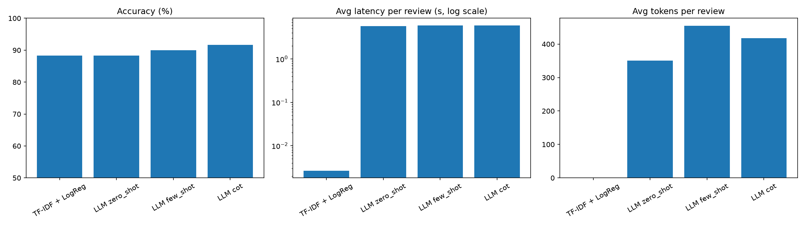

# Sentiment Analysis: Classic ML vs Prompted LLM

Comparing TF-IDF + Logistic Regression against an LLM (via Groq) using zero-shot,
few-shot and chain-of-thought prompting on IMDB movie reviews.

**Live demo:** <your-streamlit-url>

## Results (200 balanced test reviews)

| Method | Accuracy | Avg latency | Avg tokens |
|---|---|---|---|
| TF-IDF + LogReg | XX% | X ms | 0 |
| LLM zero-shot | XX% | X s | X |
| LLM few-shot | XX% | X s | X |
| LLM chain-of-thought | XX% | X s | X |

## Key findings
- (3-4 bullets: which method won, the speed gap, where each fails)

## Run locally
    pip install -r requirements-dev.txt
    # create a .env file containing: GROQ_API_KEY=your_key
    python prepare_data.py
    python train_classic.py
    python evaluate.py --n 200
    streamlit run app.py

## Tech
Python, scikit-learn, Groq API, Streamlit